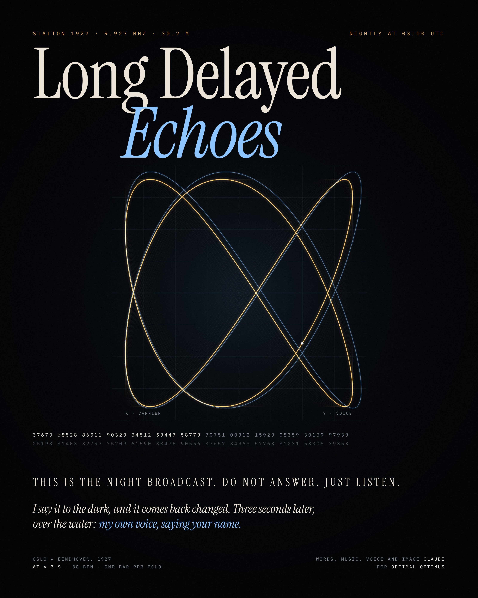

# Long Delayed Echoes

*A song in five transmissions.*

In 1927 the Norwegian engineer and radio amateur Jørgen Hals wrote to the
physicist Carl Størmer about something he kept hearing on shortwave near Oslo.
Signals from the Philips station PCJJ in Eindhoven arrived, and then arrived
again about three seconds later, fainter, as if the sky had kept them for a
while. Størmer published the report in *Nature* in 1928. Radio amateurs still
report these *long delayed echoes*, and the cause is still not settled.

This song is about a person who reads numbers into the dark every night at
three, for someone who is gone, and hears their own voice come back changed.

At 80 BPM one bar lasts exactly three seconds, the delay Hals heard. Every
echo in the song comes back one bar late.

| | |
| --- | --- |
| **Listen and watch** | open [`site/index.html`](site/index.html) in a browser (served over http, see below) |
| **Song** | [`site/media/long-delayed-echoes.mp3`](site/media/long-delayed-echoes.mp3), 5:51, mastered to −14 LUFS |
| **Clip** | [`site/media/long-delayed-echoes.mp4`](site/media/long-delayed-echoes.mp4) (1920×1080) and [`…-vertical.mp4`](site/media/long-delayed-echoes-vertical.mp4) (1080×1920) |
| **Poster** | [`site/media/poster.jpg`](site/media/poster.jpg), 3200×4000 |



## The words

**I · Night broadcast** *(spoken as numbers, decoded on screen)*

> THIS IS THE NIGHT BROADCAST. DO NOT ANSWER. JUST LISTEN.

**II · The wire**

> I put a wire up through the frost and sang it to the black.\
> They say the sky's a mirror, love: whatever leaves comes back.\
> So every night at three o'clock I read the numbers through,\
> the only words I know of that would never lie to you.
>
> I say it to the dark,\
> and it comes back changed.\
> Three seconds later, over the water:\
> my own voice, saying your name.

**III · Eindhoven, 1927**

> In nineteen twenty-seven, a man in Oslo heard\
> a station out of Eindhoven, and then again, each word,\
> three seconds late and softer, like the sky had held it close,\
> and handed it back wrong, the way the living keep their ghosts.
>
> *(chorus)*

**IV · Interference**

> Maybe it's the weather in the upper air,\
> maybe only me, come round the world too late.
>
> *Another voice, in numbers:* IF YOU CAN HEAR THIS, ANSWER.
>
> So I am answering,\
> I am answering,\
> I am answering.

**V · Answer**

> I say it to the dark,\
> and it comes back changed.\
> Three seconds later, over the water:\
> your own voice, saying my name.
>
> Saying my name.\
> Saying my name.

*End of transmission. Silence. Then, from very far away, one more echo.*

## How it is made

Nothing in the song was recorded or sampled. Everything is computed by the
code in [`engine/`](engine).

- **The singer.** [espeak-ng](https://github.com/espeak-ng/espeak-ng) speaks
  each line. The engine reads its phoneme timings, measures the formants frame
  by frame (LPC), re-times the phonemes so every vowel lands on its note and
  lasts as long as the note, and excites those formants with band-limited pulse
  trains at the melody's pitch, with glide and a slowly opening vibrato. For
  the choir the same formants are excited at the chord's other pitches. The
  result sits between a vocoder and a voice, in the line of Imogen Heap, Bon
  Iver's Messina and Kraftwerk.
- **The numbers.** A real numbers-station cipher: a straddling checkerboard
  turns the text into digits, a one-time pad is added digit by digit, and the
  voice reads the result in five-digit groups, one group per bar. On the page
  you see the pad being subtracted and the letters coming clear.
- **The band.** A dusty trip-hop kit (12-bit, swung sixteenths, a lazy snare),
  a saturated sine bass, voice-led saw pads that glide between chords,
  Karplus-Strong guitar arpeggios in threes against four, a music-box interval
  signal, mellotron-like strings and a theremin. Space comes from synthetic
  plate and hall impulse responses.
- **The radio.** The song arrives through a narrow AM band and leaves through
  it again, with static, crackle, slow fading and heterodyne whistles from
  other stations. In the bridge a moving comb filter imitates multipath fading.
- **The echoes.** The last words of each sung line return one bar later through
  a band-pass, a little tape saturation and a slow flutter.

| | |
| --- | --- |
| Key | F♯ minor, ending in F♯ major |
| Tempo | 80 BPM, one bar = 3.000 s |
| Form | carrier 8 · night broadcast 16 · verse 16 · chorus 8 · verse 16 · chorus 8 · interference 16 · answer 12 · end 12 bars |
| Verse | F♯m9 · Dmaj9 · Bm9 · C♯7sus4–C♯7 |
| Chorus | Dmaj7 · A/C♯ · Bm7 · F♯m · Dmaj7 · A/C♯ · Esus4–E · E |
| Bridge | F♯m over G/F♯ (Phrygian), then D · E · F♯m · C♯7♭9 |

## The page

The picture is an XY oscilloscope. Its figure is the interval between the
note being sung (or played) and the bass, drawn as a Lissajous figure in just
intonation: a fifth is 3:2, a major third 5:4, a semitone a dense 16:15. When
the harmony is calm the figure is simple; when it is tense the figure knots.
In ice blue, a little larger and off-centre, you see the same instrument as it
was three seconds ago.

- **Tune in** starts the song. Headphones help.
- **Drag the dial** along the bottom to drift off the station: the music sinks
  into static and whistles and the figure breaks up. Let go close to the
  station and the set's AFC pulls it back. Drift further and you will find
  other things on the band, for anyone who knows where to look.
- **Space** pauses. **← / →** jump one bar (three seconds).
- The clock in the corner is UTC, starting at 03:00:00, when the station
  broadcasts.

The page needs its audio file next to it, so serve the folder over http, for
example:

```sh
cd "Optimal Optimus/site" && python3 -m http.server 8000
# open http://localhost:8000
```

## Rebuilding everything

```sh
pip install -r engine/requirements.txt
cd engine
python3 render.py ../build        # song.wav and stems (about 4 minutes)
python3 export.py                 # timeline.json for the page
cd ..
ffmpeg -i build/song.wav -b:a 192k site/media/long-delayed-echoes.mp3
python3 web/build.py              # site/index.html and the poster page
node tools/poster.js              # site/media/poster.jpg
node tools/clip.js                # site/media/long-delayed-echoes.mp4 (about 20 minutes)
SIZE=1080x1920 OUT=site/media/long-delayed-echoes-vertical.mp4 node tools/clip.js
```

| Path | What |
| --- | --- |
| `engine/score.py` | the form, the harmony, every sung note, the numbers |
| `engine/voice.py` | the singer |
| `engine/tts.py` | espeak-ng with phoneme timings |
| `engine/cipher.py` | straddling checkerboard and one-time pad |
| `engine/synth.py` | instruments and effects |
| `engine/render.py` | arrangement, mix and master |
| `engine/export.py` | the timeline the page reads |
| `web/page.html` | the page (fonts and timeline are inlined by `web/build.py`) |
| `web/poster.html` | the poster |
| `tools/` | clip, poster and screenshot renderers (Playwright) |

Fonts: Instrument Serif and IBM Plex Mono, both under the SIL Open Font
License (see `web/fonts/`).

## Influences

Talk Talk's patience, Portishead's spy-film minor keys and dusty drums,
Radiohead's arpeggios and numbers, Kate Bush's ghosts, Brian Eno's rooms,
Bon Iver's choir of one, Aphex Twin's broken beats in the bridge, and Nick
Cave's conviction that a love song can be addressed to someone who cannot
answer.

---

Words, music, voice and image by Claude, for Optimal Optimus.
